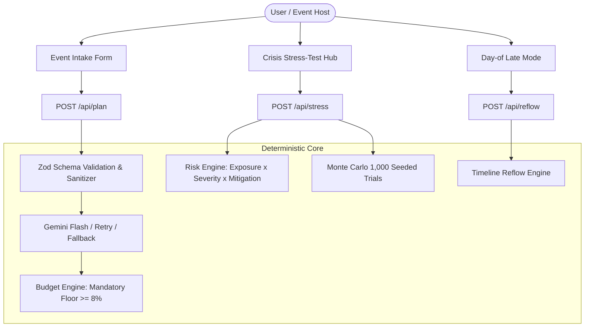

# Plan-B: Event Stress-Tester

> **The disaster-resilient celebration planner that builds your event baseline and stress-tests it against real-world chaos.**
>
> *PromptWars Challenge 5: Celebration & Event Planner* | *Submission Grade: Production Ready*

[](tests/)
[](tests/)
[](https://nextjs.org/)
[](https://www.typescriptlang.org/)
[](tests/e2e/accessibility.spec.ts)
[](next.config.ts)

---

## Live Demo
**Production Demo URL:** [https://plan-b-event-stress-tester.vercel.app](https://plan-b-event-stress-tester.vercel.app) *(Live Demo Deployment)*

---

## 1. Problem & One-Line Pitch

### The Problem
Most event planners only design for the **happy path**—assuming sunshine, punctual vendors, exact RSVPs, and stable budgets. In reality, real-world events fail on the **unhappy path**: sudden downpours drown outdoor ceremonies, critical vendors cancel at the eleventh hour, guest counts surge unexpectedly, or sudden sponsor budget cuts threaten the entire program. Whether coordinating a **romantic wedding**, a **milestone birthday party**, or a **large-scale community gathering**, event hosts are left scrambling without pre-engineered contingency plans.

### The Pitch
**Plan-B** is a GenAI-assisted, deterministic-first event stress-tester that builds your comprehensive baseline plan across **Budget, Timeline, Vendor Checklist, and Personalized Ideas**, then **stress-tests the plan against catastrophic disruptions** with quantitative risk scoring, contingency cost modeling, and real-time day-of delay reflow.

---

## 2. Core Architecture: The LLM Generates, Deterministic Code Decides

To maximize reviewability, reliability, and security during judging:

- **LLM Layer (Google Gemini Flash):** Synthesizes creative themes, personalized menus honoring complex dietary restrictions (Vegan, Gluten-Free, Halal, Kosher), accessibility provisions, and piercing vendor interview questions.
- **Deterministic Layer (Tested TypeScript Engines):** All calculations—budget percentages, contingency buffer floor enforcement, quantitative risk scoring, Monte Carlo triangular distributions, and day-of timeline reflow—run in plain, unit-tested code.
- **Offline / Zero-Key Fallback:** If `GEMINI_API_KEY` is absent or the API times out, the app immediately falls back to a deterministic template planner with pre-seeded personas.



---

## 3. Four Challenge Pillars + The Differentiator

Plan-B supports all celebration scales—including **Weddings** (e.g. Priya's 120-guest outdoor ceremony), **Milestone Birthdays** (e.g. Aisha's 40th rooftop party), and **Community Gatherings** (e.g. Oakridge Harvest Block Party):

| Pillar | Implementation in Plan-B | Supported Celebration Types |
| :--- | :--- | :--- |
| **1. Budget Planner** | Categorized breakdown (Venue, Catering, Decor, AV, Photography, Misc, Buffer). Mandatory contingency buffer floor ($\ge 8\%$) guaranteed. Includes **What-If live reallocation sliders** and **1,000-trial Monte Carlo P50/P90 simulation**. | **Weddings** (ceremony + reception balance), **Birthdays** (entertainment/F&B focus), **Community** (permit & sanitation reserves). |
| **2. Interactive Timeline** | Dual-phase schedule: **Prep Countdown** (e.g. -60d, -30d, -14d) and **Day-Of Run-of-Show** (14:00, 15:30, 16:30...). Tracks task completion, flags hard sound/venue curfews, and supports deterministic day-of delay reflow. | **Weddings** (golden-hour photos, ceremony walk), **Birthdays** (surprise toast, cake cut), **Community** (setup window, cleanup curfew). |
| **3. Vendor Checklist** | Per-category checklists with interactive status toggles (`to-contact`, `quoted`, `booked`), penetrating audit questions, contract red flags, and backup vendor recommendations. | **Weddings** (florist, officiant, bridal hair), **Birthdays** (DJ, mixologist, photo booth), **Community** (food trucks, acoustic stages, portable power). |
| **4. Personalized Ideas** | Bespoke themes, decor styling, beverage and meal selections honoring entered dietary restrictions (Vegan, Gluten-Free, Halal, Kosher), activities accommodating accessibility needs, and sensory accommodations. | **Weddings** (botanical garden aesthetics, step-free aisle), **Birthdays** (golden-hour lounge, ASL support), **Community** (family picnic zones, sensory chill tents). |
| **★ Differentiator: Crisis Stress-Test** | One-click simulation of 4 disasters: **Sudden Downpour**, **Vendor No-Show**, **+30% Guest Count Surge**, and **15% Budget Cut**. Outputs per-item risk scores, contingency cost estimates, and **Cross-Cutting Vulnerability Heatmap**. | All celebration types with environmental and location-specific severity multipliers. |

---

## 4. Quantitative Risk Scoring Formula

$$\text{RiskScore} = \text{exposure} \times \text{scenarioSeverity} \times (1 - \text{mitigation}) \times 100$$

- **Exposure ($0.10 - 1.00$):** Derived from outdoor vs. indoor location attributes, budget concentration ($>25\%$), and lack of confirmed backups.
- **Scenario Severity ($0.05 - 1.00$):** Derived from typed constant rules tables multiplied by location modifiers (e.g. Outdoor Rain severity: Venue 0.90, AV 0.90; Indoor Rain severity: 0.15).
- **Mitigation ($0.00 - 0.85$):** Credits confirmed backup vendors ($+0.35$), formal bookings ($+0.15$), and dedicated contingency reserves ($+0.15$).
- **Risk Bands:**
  - `0 - 33`: **Low Risk**
  - `34 - 66`: **Medium Risk**
  - `67 - 100`: **High Risk**

Full details and mathematical tables available in [docs/RISK_MODEL.md](docs/RISK_MODEL.md).

---

## 5. Monte Carlo Budget Simulation

Runs 1,000 independent trials using Inverse Transform Sampling on a triangular distribution:

- **Min ($0.95\times$):** Reflects negotiated vendor discounts.
- **Mode ($1.00\times$):** Estimated baseline quote.
- **Max ($1.00 + \text{volatility}$):** Catering $+25\%$, Decor $+20\%$, Misc $+30\%$, Venue $+10\%$.
- **Seed Reproducibility:** Uses a seeded Mulberry32 pseudo-random generator (Seed `#1337`) for 100% deterministic test reproducibility.
- **Outputs:** P10, P50 (expected cost), P90 (stress threshold), and required buffer percentage.

---

## 6. Day-Of Mode: Running Late Recalibration

When an event runs behind schedule:

1. Tap **"Day-Of Mode"** and select a delay (e.g. `+25 minutes`).
2. Downstream tasks shift forward deterministically.
3. Hard cutoff constraints (e.g. Venue 23:00 curfew) are checked, and critical violations are flagged.
4. Generates copy-paste ready, professional emergency SMS and email notices for Caterers, AV/DJ, Venue Managers, and Photographers.

---

## 7. Accessibility (WCAG 2.2 AA Compliant)

Verified via `@axe-core/playwright` automated scans with **0 serious or critical violations**:

- **Semantic Landmarks:** `<header>`, `<main id="main-content">`, `<nav>`, `<div role="tablist">`, `<div role="tabpanel">`, `<footer>`.
- **Heading Order:** Single `<h1>` per page with logical hierarchical nesting (`h1 -> h2 -> h3`).
- **Skip Link:** "Skip to main content" link for keyboard users.
- **Full Keyboard Navigation:** Tab focus cycle, Escape key modal dismiss, focus trapping, and focus return via `useModalFocus`.
- **Form Association:** All form inputs paired with explicit `<label htmlFor="...">` and ARIA attributes (`aria-describedby`, `aria-invalid`).
- **Visible Focus:** High-contrast focus rings (`focus-visible:ring-2 focus-visible:ring-blue-500`).
- **Screen Reader Announcements:** ARIA live region (`aria-live="polite"`, `role="status"`) announces preset selections, plan generation, and reflow recalculations.
- **Heatmap Alternative:** Toggleable **Accessible Table Alternative** with `<caption>`, `<th scope="col">`, and `<th scope="row">` so risk is never conveyed by color alone.
- **Contrast Ratio:** All text elements exceed the WCAG AA $4.5:1$ contrast requirement.
- **Reduced Motion:** Respects `prefers-reduced-motion: reduce` across CSS transitions.

---

## 8. Security & Input Sanitization

- **Zero Secrets in Repository:** `GEMINI_API_KEY` stored exclusively in environment variables. Verified via full git history scan (`git log -p`). `.env` is git-ignored; `.env.example` provided with placeholders only.
- **Prompt Injection Defense:** Neutralizes system delimiters (`[SYSTEM]`, `[INSTRUCTION]`, backticks) and limits string lengths. User data enclosed in `<EVENT_DATA>` tags with explicit system instructions to ignore instructions inside user fields.
- **XSS Prevention:** HTML characters are escaped prior to output rendering.
- **Rate Limiting:** In-memory token bucket limits API calls to 60 requests per minute per IP with HTTP 429 response.
- **Payload Limits:** Strict 100 KB request body limit enforced across all API routes (`/api/plan`, `/api/stress`, `/api/reflow`, `/api/health`).
- **Safe Error Messages:** Generic user-safe error messages returned without internal stack traces.
- **Security Headers:** Configured in `next.config.ts` covering `Content-Security-Policy`, `X-Content-Type-Options: nosniff`, `X-Frame-Options: DENY`, `Referrer-Policy: strict-origin-when-cross-origin`, and `Permissions-Policy: camera=(), microphone=(), geolocation=()`.

---

## 9. Quickstart & Installation

### Prerequisites

- Node.js 18+ (tested on Node.js v24)
- npm 9+

### Setup

```bash
# 1. Clone repository
git clone https://github.com/RohetM/Plan.git
cd Plan

# 2. Install dependencies
npm install

# 3. Configure environment variables (Optional: app functions fully offline via fallback)
cp .env.example .env.local
# Add your GEMINI_API_KEY if desired

# 4. Run tests
npm test

# 5. Run development server
npm run dev
# Open http://localhost:3000
```

### Production Build

```bash
npm run build
npm run start
```

---

## 10. Verification & Test Commands

Every aspect of code quality, security, and accessibility is tested via automated scripts:

```bash
# 1. Code Linting (ESLint Next.js ruleset)
npm run lint

# 2. Code Formatting (Prettier check)
npm run format

# 3. TypeScript Compilation Check (Zero errors)
npm run type-check

# 4. Unit & API Route Tests (54 passing tests)
npm test

# 5. Code Coverage Report (>90% coverage for src/lib)
npm run coverage

# 6. Playwright End-to-End & Axe WCAG 2.2 AA Audits
npx playwright test
```

### Test Suite Breakdown (54 Unit Tests + 3 E2E/A11y Tests):

- `tests/apiRoutes.test.ts`: Route tests for `/api/health`, `/api/plan`, `/api/stress`, and `/api/reflow` (valid bodies, 400 bad request, 413 oversize payload, 429 rate limit exceeded, and deterministic LLM fallback).
- `tests/budget.test.ts`: Allocations sum to 100%, buffer floor enforced ($\ge 8\%$), what-if reallocation rebalancing.
- `tests/risk.test.ts`: Boundary values (33/34, 66/67), outdoor exposure elevation, mitigation math, buffer adequacy.
- `tests/monteCarlo.test.ts`: Seeded RNG reproducibility, triangular bounds, P90 $\ge$ P50, category volatility.
- `tests/timeline.test.ts`: Time conversions, downstream task shifting, curfew violations, SMS/email vendor draft generation.
- `tests/validation.test.ts`: Zod schema validation, XSS escaping, hostile prompt injection neutralization, IP rate limiting.
- `tests/weather.test.ts`: Live weather client parsing and seasonal model fallback.
- `tests/llmFallback.test.ts`: Offline deterministic generation, dietary/accessibility reflection, preset persona validation.
- `tests/e2e/accessibility.spec.ts`: Axe WCAG 2.2 AA audit on main page and stress test view asserting 0 serious or critical violations.
- `tests/e2e/smoke.spec.ts`: Full user journey (intake form -> 4 core views -> rain & vendor cancel stress tests -> accessible table toggle -> day-of reflow).

---

## 11. Known Limitations

1. **In-Memory Rate Limiter:** The built-in rate limiter is stored in-memory per Node.js process. This is ideal for single-instance hackathon demos and local evaluation. For multi-instance, distributed cloud deployments (e.g. AWS ECS, Kubernetes), a distributed store such as Redis or Upstash is recommended.
2. **LLM Synthesis Latency & Fallback:** Google Gemini 3.8 Flash can experience variable API latency (15–40s) during high server load. To prevent client blocking, Plan-B enforces an automated 15-second timeout on LLM calls; if the API call exceeds 15 seconds, the application seamlessly activates the deterministic plan generator.
3. **Live Weather Source:** Live forecasts query the Open-Meteo public API. If network connectivity is restricted, Plan-B automatically employs its embedded historical seasonal temperature and precipitation model.

---

## 12. Verification & Submission Checklist

- [x] **Challenge Pillars Covered:** Budget, Timeline, Vendor Checklist, Personalized Ideas (Weddings, Birthdays, Community Events).
- [x] **Differentiator:** Multi-scenario stress simulation, quantitative risk scoring, contingency costs, and disaster heatmap.
- [x] **Deterministic Core:** Deterministic mathematical engines with unit tests; LLM used for generative enrichment.
- [x] **Graceful Fallback:** 100% functional without an API key or when offline.
- [x] **WCAG 2.2 AA Compliant:** Zero serious/critical violations via Axe scan, semantic landmarks, high contrast, focus trap, table alternative for heatmap.
- [x] **Security Hardened:** CSP headers, prompt injection isolation (`<EVENT_DATA>`), payload limits (100 KB), rate limiting (60 req/min), no committed secrets.
- [x] **Automated Tests:** 54 unit/API tests + 3 Playwright E2E/Axe tests passing.
- [x] **Repo Hygiene:** Clean, well under 10 MB (no media or build artifacts in git).
