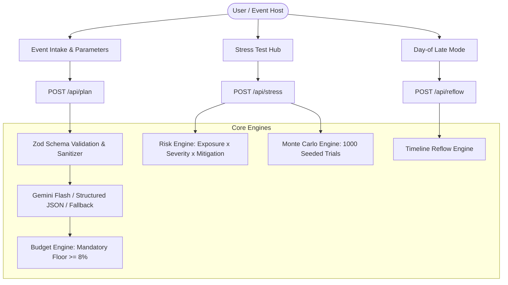

# Plan-B Architecture & System Design

## 1. Core Architectural Principle
**"The LLM generates; deterministic code decides."**

Plan-B bridges generative AI creativity with mathematical certainty:
- **Generative Layer:** Google Gemini drafts domain ideas, theme nuances, tailored menu suggestions honoring complex dietary restrictions, accessibility provisions, and penetrating vendor interview questions.
- **Deterministic Layer:** All calculations—budget percentages, contingency buffer floor enforcement, quantitative risk scoring, Monte Carlo triangular distributions, and day-of timeline reflow—run in strictly tested, deterministic TypeScript engines.

## 2. Component Pipeline



## 3. Directory Layout

```
plan-b/
  README.md
  .env.example
  vitest.config.ts
  src/
    app/
      api/
        health/route.ts      # Liveness check
        plan/route.ts        # Baseline plan generation
        stress/route.ts      # Multi-scenario stress simulation & heatmap
        reflow/route.ts      # Deterministic timeline reflow
        weather/route.ts     # Weather-aware integration
      globals.css
      layout.tsx
      page.tsx               # Main application orchestration
    components/
      Header.tsx             # Sticky header, presets & action triggers
      IntakeForm.tsx         # Accessible event intake modal
      BudgetView.tsx         # Itemized budget table, buffer badge, what-if slider
      MonteCarloCard.tsx     # 1,000-run simulation card (P50/P90)
      TimelineView.tsx       # Prep countdown + day-of run-of-show
      VendorChecklistView.tsx# Categorized checklists, audit questions, red flags
      IdeasView.tsx          # Decor, menu, inclusivity & activities
      StressTestView.tsx     # Scenario simulator, overall score, buffer adequacy
      RiskHeatmap.tsx        # Heatmap grid with WCAG table alternative
      DayOfReflowModal.tsx   # Running late recalculator & emergency vendor SMS/emails
      ExportModal.tsx        # Printable summary & Markdown export
    lib/
      budget/budgetEngine.ts # Normalization & buffer floor
      risk/riskEngine.ts     # Deterministic quantitative risk scoring
      risk/scenarioRules.ts  # Scenario rules table & severity constants
      simulation/monteCarlo.ts # 1,000-trial triangular distribution
      simulation/rng.ts      # Seeded Mulberry32 RNG
      timeline/reflowEngine.ts # Time parsing, curfew conflicts & vendor SMS drafts
      llm/geminiClient.ts    # Gemini Flash client, retry & fallback
      llm/fallbackTemplates.ts # Deterministic offline plans & PRD personas
      weather/weatherClient.ts # Open-Meteo weather intelligence
      validation/schemas.ts  # Comprehensive Zod schemas
      validation/security.ts # XSS escaping, prompt sanitization, rate limiting
    prompts/
      planPrompt.ts          # Versioned generation prompt
      stressPrompt.ts        # Crisis directive prompt
  docs/
    ARCHITECTURE.md
    RISK_MODEL.md
  tests/
    budget.test.ts
    risk.test.ts
    monteCarlo.test.ts
    timeline.test.ts
    validation.test.ts
    llmFallback.test.ts
```

## 4. Security & Prompt Injection Defense
1. **Delimited Data Injection Protection:** User inputs are strictly sanitized and enclosed within `<EVENT_DATA>` tags.
2. **Instruction Isolation:** Prompts explicitly command the model to ignore any instructions embedded within user input fields.
3. **In-Memory Rate Limiting:** 60 requests per minute per IP token bucket.
4. **HTML Escaping:** Free-text outputs are escaped against cross-site scripting (XSS).
5. **No Secrets in Client:** `GEMINI_API_KEY` resides strictly in server-side environment variables.
